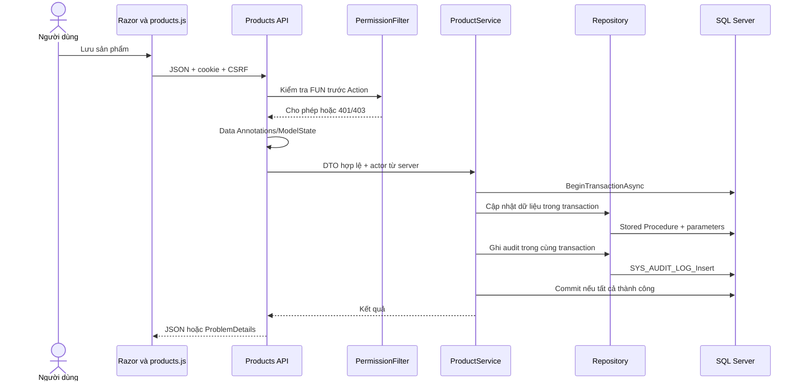
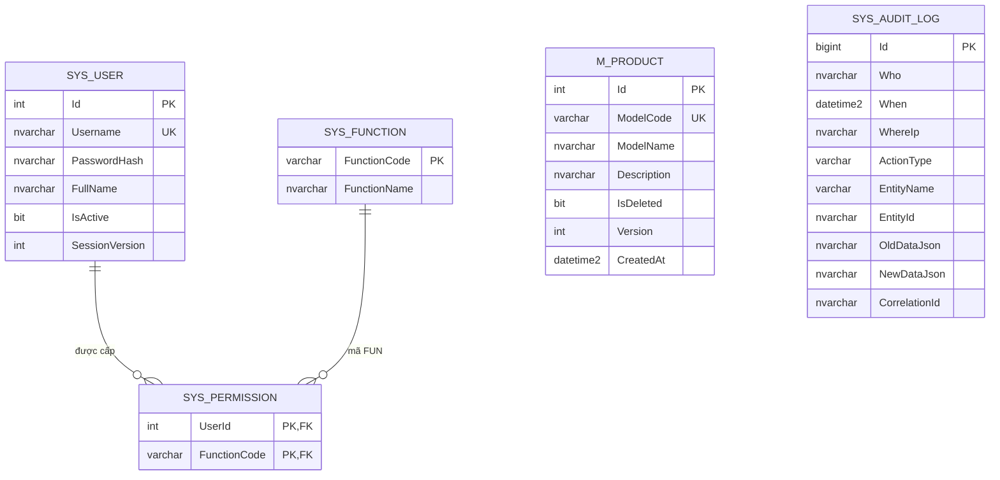

# Mốc 1 — Nền tảng ASP.NET Core, đăng nhập và sản phẩm

Ngày cập nhật: 29/10/2026. **Trạng thái: đang triển khai, chưa nghiệm thu phần SQL Server.**

## 1. Mục tiêu và phạm vi

Xây dựng một ứng dụng Web ASP.NET Core dễ đọc, không thêm framework frontend. Luồng đầu tiên: đăng nhập → kiểm tra FUN → quản lý sản phẩm → xem audit. Đây là nền tảng để mở rộng sản xuất, không phải bản MES hoàn chỉnh.

Đã viết mã cho: MVC/Razor; Web API; cookie authentication; PasswordHasher; quyền trang/nút/API; validation; SP/Dapper; transaction/audit sản phẩm; xóa mềm; kiểm soát phiên bản sửa dữ liệu; trang audit; CLI khởi tạo và bootstrap hai tài khoản mẫu.

Chưa triển khai: màn hình CRUD tài khoản/cấp quyền, trạm, lỗi, routing, WO, barcode, Dashboard sản xuất, SignalR và AI. Chưa tạo tài khoản hoặc dữ liệu thật trong môi trường hiện tại vì chưa có SQL Server.

## 2. Use Case của mốc này

| UC | Actor / điều kiện trước | Đầu vào / đầu ra | Luồng chính và ngoại lệ |
|---|---|---|---|
| Đăng nhập | Tài khoản đã bootstrap, đang hoạt động | Username/password → cookie phiên | Validate DTO/CSRF; SP lấy hash; PasswordHasher kiểm tra; đọc FUN từ DB; tạo cookie. Sai thông tin: thông báo chung, không tạo phiên; quá 10 lần/IP/phút: 429 |
| Xem sản phẩm | Đã đăng nhập, có MODEL_VIEW | Không có input nghiệp vụ → tối đa 200 sản phẩm đang dùng | Quyền trang và API được kiểm tra riêng; API gọi Service/Repository/SP. Thiếu đăng nhập: 401 API; thiếu FUN: 403 |
| Thêm sản phẩm | Có MODEL_ADD và CSRF hợp lệ | Mã/tên/mô tả → sản phẩm version 1 | Validate; mở transaction; SP insert; audit với dữ liệu sau; commit. Sai DTO: 400; trùng mã: 409; lỗi audit: rollback |
| Sửa sản phẩm | Có MODEL_EDIT, biết version đang đọc | Id, mã/tên/mô tả/version → version +1 | Transaction; SP lấy bản ghi với UPDLOCK/ROWLOCK; kiểm tra tồn tại/version; SP update và audit trước/sau; commit. Không tồn tại: 404; version cũ: 409 |
| Ngừng sử dụng | Có MODEL_DELETE, version hợp lệ | Id/version → 204 | Transaction; khóa/kiểm tra; đặt IsDeleted=1; audit trước/sau; commit. Không xóa vật lý; mã sản phẩm vẫn được giữ duy nhất |
| Xem nhật ký | Có AUDIT_VIEW | Không input → tối đa 200 thay đổi mới nhất | Chỉ đọc, không có endpoint sửa/xóa nhật ký; hiển thị thời gian Việt Nam và JSON dưới dạng text an toàn |

Hậu điều kiện của mỗi mutation thành công: dữ liệu sản phẩm và đúng một audit cùng tồn tại. Nếu bước ghi nghiệp vụ hoặc audit lỗi, toàn bộ transaction phải rollback. **Hậu điều kiện này đã được viết trong mã và test case, chưa được thực nghiệm trên SQL Server ở môi trường hiện tại.**

## 3. Luồng giữa các tầng

Tài khoản và FUN được đọc lại từ DB mỗi request có cookie. Tài khoản bị vô hiệu hóa hoặc đổi SessionVersion thì cookie không còn được chấp nhận; thay đổi FUN được áp dụng khi request kế tiếp kiểm tra quyền. Không tin FUN từ browser. `IAuthorizationFilter` chỉ đọc claims đã được máy chủ xác minh; việc truy vấn async diễn ra trong cookie validation.

Không thêm interface cho mọi bảng hoặc thư viện mapping/mediator. Controller không gọi DB; Service quản lý transaction; Repository chỉ gọi SP có tên cố định và tham số. DDL chỉ được chạy từ CLI bằng các script cố định trong bản phát hành.

## 4. Thiết kế dữ liệu đã viết

`SYS_AUDIT_LOG.Who` lưu Id tài khoản ở thao tác web; bootstrap/migration dùng `System`. Không đặt FK bắt buộc tới user vì có tác nhân hệ thống và cần giữ lịch sử. EntityName/EntityId xác định bản ghi bị thay đổi, không là một FK đa hình được SQL Server cưỡng chế. Thời gian lưu UTC; model khôi phục DateTime.Kind UTC khi đọc datetime2 để JSON trả timestamp có `Z`.

Giới hạn: Username 50; hash 600; FullName/ModelName 200; ModelCode 50 ký tự; Description 1000; IP 45. Mã sản phẩm duy nhất kể cả sau xóa mềm. Version số nguyên tăng sau cập nhật/ngừng dùng; client phải gửi version đã đọc. Unique/check constraints là lớp bảo vệ DB bổ sung, không thay validation API.

| SP | Trách nhiệm |
|---|---|
| SYS_USER_GetByUsername | Lấy thông tin xác thực phía server, không trả hash ra API |
| SYS_USER_GetSession | Lấy trạng thái tài khoản và FUN hiện tại; không lấy hash |
| SYS_USER_Bootstrap | Tạo tài khoản/quyền mẫu nếu chưa tồn tại; yêu cầu transaction bên gọi |
| M_PRODUCT_List | Lấy tối đa 200 sản phẩm đang dùng |
| M_PRODUCT_GetForUpdate | Đọc có khóa trong transaction |
| M_PRODUCT_Create / Update / Delete | Insert, update kiểm version, xóa mềm; bắt buộc có transaction |
| SYS_AUDIT_LOG_Insert | Ghi audit trong transaction nghiệp vụ |
| SYS_AUDIT_LOG_List | Đọc tối đa 200 log mới nhất |
| SYS_Health | Kiểm tra truy cập danh mục FUN cho readiness |

Khởi tạo lại không xóa dữ liệu, không đổi mật khẩu, không tự cấp lại quyền cho user đã có. Dữ liệu FUN mới được ghi kèm audit trong transaction. Thay đổi schema tương lai phải bổ sung script có phiên bản; không coi IF NOT EXISTS là công cụ migration hoàn chỉnh.

## 5. API và quyền

Mọi endpoint thay đổi dữ liệu đều chịu kiểm tra antiforgery toàn cục; API login cũng cần token anonymous trước khi gửi thông tin đăng nhập.

| Method / route | Quyền / đầu vào | Kết quả chính |
|---|---|---|
| GET /api/auth/csrf | Anonymous hoặc user hiện tại | 200, token; không cache |
| POST /api/auth/login | Anonymous, LoginDto, CSRF; rate limit | 200 + cookie hoặc 400/401/429 |
| POST /api/auth/logout | Đăng nhập + CSRF | 204, xóa cookie |
| GET /api/auth/me | Đăng nhập | 200 thông tin công khai và FUN, không có hash |
| GET /api/products | MODEL_VIEW | 200 danh sách |
| POST /api/products | MODEL_ADD, ProductCreateDto | 201, 400, 409 |
| PUT /api/products/{id} | MODEL_EDIT, ProductUpdateDto có Version | 200, 400, 404, 409 |
| DELETE /api/products/{id} | MODEL_DELETE, JSON có Version | 204, 400, 404, 409 |
| GET /api/audit-logs | AUDIT_VIEW | 200 danh sách log |

Mọi API được bảo vệ: chưa đăng nhập → 401; thiếu FUN → 403; không redirect sang HTML login. Lỗi bất ngờ trả 500 với thông báo chung và traceId, không trả stack trace. Lỗi CSRF mặc định của MVC có thể không có JSON body; JavaScript xử lý được trường hợp này.

Trang MVC: Home cần đăng nhập; Products cần MODEL_VIEW; AuditLogs cần AUDIT_VIEW. Nút/form thêm/sửa/ngừng dùng được render theo từng FUN. Login và AccessDenied có thể truy cập khi chưa đăng nhập.

Mật khẩu băm bằng PasswordHasher với 200.000 vòng PBKDF2; cookie HttpOnly/SameSite=Strict, tối đa 8 giờ, không sliding renewal. Production dùng Secure cookie và HTTPS; môi trường Development hỗ trợ local HTTP. Có CSRF, CSP chặn inline script, no-store cho trang quản trị. JavaScript đưa dữ liệu vào DOM qua textContent, không ghép dữ liệu sản phẩm/audit vào HTML.

## 6. Kết quả kiểm chứng hiện tại

| Kiểm tra | Kết quả thực tế |
|---|---|
| SDK | .NET SDK 10.0.403, tải từ Microsoft và xác minh SHA512 |
| Restore | Thành công; giữ NuGet vulnerability audit, lockfile đã sinh |
| Dependency | SqlClient kéo Pkcs 9.x có cảnh báo; đã pin Pkcs 10.0.14, restore/build không còn cảnh báo đó; không tắt audit |
| Build solution | Thành công, 0 warning, 0 error |
| HTTP test | **12 passed**: anonymous/quyền API và trang; nút viewer; CSRF; DTO; version bắt buộc; trang login và security headers |
| SQL integration | **8 skipped**, thiếu SQL Server/connection string; không ghi là passed |
| Kestrel thực | Khởi động trên cổng 5080, Development |
| GET /health/live | 200 |
| GET /Account/Login | 200, có password input và antiforgery token |
| CSS/JavaScript | Request tài nguyên trả 200 |
| GET /api/products anonymous | 401 |
| GET /health/ready | **503**, đúng với tình trạng chưa cấu hình DB |
| Kiểm thử trình duyệt tương tác | Chưa chạy; request/render Razor không chứng minh toàn bộ JavaScript thao tác form đúng |
| Deploy ngoài localhost | Chưa thực hiện |

Nhóm HTTP dùng authentication handler chỉ tồn tại trong project test để kiểm tra pipeline filter/validation và Razor độc lập DB. Nó **không** chứng minh PasswordHasher, cookie validation, SQL/SP hay transaction đã hoạt động từ đầu đến cuối.

Tám ca SQL đã viết: đăng nhập/đăng xuất cookie và readiness; sai mật khẩu; viewer không được ghi; vòng đời sản phẩm và audit đủ trước/sau; trùng mã không tạo thêm dữ liệu; hai request sửa cùng version chỉ một thắng; Id không tồn tại; audit lỗi rollback cả create/update/delete. Fixture kiểm tra connection string và database thực tế đều phải là `MiniMES_Tests`. Cần chạy và xử lý kết quả thật khi có SQL Server; việc đã viết test không bảo đảm chúng sẽ pass.

File kết quả lần chạy ở `tests/MiniMES.Tests/TestResults/phase-01.trx` (generated, không track). Lệnh tái lập nằm trong README; các kết quả này không thay thế kiểm thử trên môi trường triển khai.

## 7. Blocker và điều kiện nghiệm thu mốc 1

`docker pull mcr.microsoft.com/mssql/server:2022-latest` đã tới registry nhưng tải blob bị Forbidden. Đã kiểm tra redirect GET, xác định CDN `westcentralus.data.mcr.microsoft.com`; host này chưa nằm trong allowlist runtime. Đã lưu bổ sung đúng host vào draft, giữ các preset hiện có. Lưu draft không áp dụng ngay vào máy đang chạy: cần lưu trong Environment settings và Publish theo giao diện sản phẩm.

Hiện không có `ConnectionStrings__MiniMes`, mật khẩu bootstrap hoặc connection string test được cung cấp trong tiến trình. Chưa cần xin token GitHub hoặc khóa AI; không cần chúng để làm mốc 1. Sau khi mạng được áp dụng, bước tiếp theo là chuẩn bị SQL Server phát triển với thông tin xác thực cục bộ được bảo vệ, database riêng, kết nối TLS có kiểm chứng, chạy initialize/seed và toàn bộ tám ca SQL. Có thể dùng SQL Server sẵn có thay cho Docker nếu truy cập được; không tự thay bằng SQLite/in-memory rồi coi đó là bằng chứng SQL Server.

Đã lưu `install_script` và `start_skill` trong draft môi trường để giữ bước cài SDK/restore/build và hướng dẫn khởi động, gồm cả blocker SQL hiện tại. Restore `--locked-mode` đã chạy thành công. Draft chưa được publish; việc lưu này không khởi động SQL Server, không cấp credential và không chứng minh khôi phục được trong một task mới. Kestrel được dừng sau smoke test; không dựa vào tiến trình của phiên này để chạy ở task sau.

Mốc 1 chỉ được nghiệm thu sau khi: DB khởi tạo và chạy lại được; đăng nhập thật; admin/viewer đúng quyền; UI thêm/sửa/ngừng dùng và audit đúng; test rollback/concurrency đạt trên SQL Server. Sau đó mới mở rộng một nhóm tiếp theo: **trạm + routing + Work Order cho một tuyến ba trạm**, giữ nguyên nền tảng MVC/Razor.
