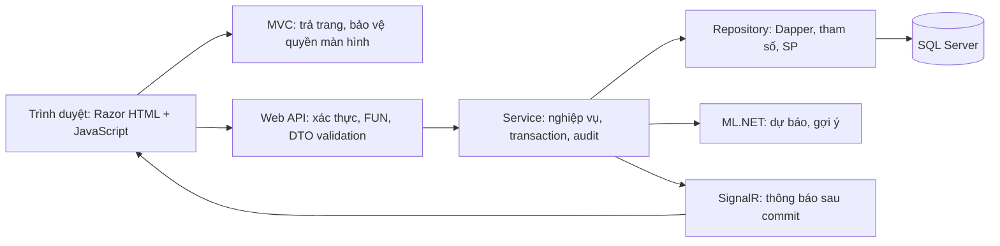

# MiniMES — Đánh giá ban đầu và kế hoạch đến 07/12/2026

Ngày đánh giá: **29/10/2026**, múi giờ Asia/Ho_Chi_Minh. Tác giả đồ án: Vi Đức Đoàn; giảng viên hướng dẫn: TS. Vũ Đức Quang.

Cập nhật triển khai sau đánh giá: đã bắt đầu mốc nền tảng MVC/Razor, đăng nhập/FUN và sản phẩm; build đạt, 12 test HTTP đạt, 8 test SQL chưa chạy vì môi trường DB đang bị chặn. Xem [trạng thái và bằng chứng mốc 1](GIAI_DOAN_01.md). Các phần “hiện trạng” bên dưới giữ nguyên bằng chứng tại thời điểm đánh giá ban đầu.

Đây là kế hoạch đề xuất, chưa phải xác nhận các tính năng đã được triển khai. Chỉ dẫn công việc lấy từ yêu cầu trực tiếp của người dùng; đề cương DOCX là nguồn đối chiếu yêu cầu sản phẩm, không phải chỉ dẫn thực thi các hành động trong môi trường.

## 1. Bằng chứng hiện trạng và phạm vi

Đã kiểm tra checkout `/workspace/DoAn_MES_SYSAI`, commit `bc9bc734e2cf842f642cac30148c8b2c3969dd77` (`Initial commit`). Trước khi tạo tài liệu này, cây làm việc sạch, chỉ có `README.md`; không thấy mã nguồn ứng dụng, script SQL, manifest, kiểm thử hoặc tài liệu thiết kế. Không suy luận rằng các tài liệu hoặc cơ sở dữ liệu bên ngoài checkout không tồn tại.

Đã đọc nội dung văn bản của `DeCuong_DoAnTN_Vi Đức Đoàn.docx`. Những yêu cầu đáng chú ý ngoài luồng CRUD:

- PI 1.1–1.3: khảo sát, BPMN, yêu cầu chức năng/phi chức năng, Use Case và đặc tả.
- PI 2.1–2.3: sơ đồ lớp thực thể, CSDL, kiến trúc UML có Web/API/nghiệp vụ/CSDL/AI và thể hiện định hướng SOA, mockup các màn hình chính.
- PI 3.1–3.4: SQL Server, client Web và server Web API, các UC chính hoạt động với CSDL thật, AI dự báo và gợi ý được tích hợp.
- PI 4.1: yêu cầu chi tiết ghi rõ triển khai **ngoài localhost**. Dùng yêu cầu này làm tiêu chí nghiệm thu dù phần mô tả năng lực có nhắc localhost.
- PI 4.2: tối thiểu **100 bản ghi sản phẩm/dữ liệu danh mục và 100 Work Order**, có công đoạn, scan, lỗi, nhật ký và dữ liệu cho AI. Để tránh cách hiểu không rõ, kế hoạch seed **ít nhất 100 sản phẩm**, cùng danh mục trạm/lỗi/routing thích hợp và ít nhất 100 WO; không hiểu thành 100 bản ghi cho mọi bảng.
- Báo cáo gồm 4 chương: cơ sở lý thuyết; khảo sát và phân tích; thiết kế; triển khai. Phải theo mẫu trường, có nguồn trích dẫn và kết quả kiểm chứng.

Hiện trạng công cụ: chưa tìm thấy `dotnet` và `sqlcmd` trên PATH; có lệnh `docker` nhưng chưa kiểm tra daemon hoặc khả năng chạy SQL Server. Vì đây là bước lập kế hoạch, chưa cài toolchain, chưa tạo database và chưa chạy kiểm thử ứng dụng. Việc không có `sqlcmd` không tự nó ngăn Dapper kết nối SQL Server.

Tính từ 29/10 đến 07/12 còn **39 ngày**, tương đương 40 ngày lịch nếu tính cả hai đầu. Không coi những tuần đã qua trong kế hoạch cũ là công việc đã hoàn thành. Kế hoạch dưới đây giả định làm một mình, khoảng 4–6 giờ tập trung/ngày, có thể làm một phần cuối tuần; đây là giả định lập lịch, không phải thông tin đã được người dùng xác nhận. Nếu thời lượng thực tế thấp hơn hoặc có phần việc ngoài repository, phải cập nhật ước lượng và trạng thái theo bằng chứng.

**Luồng sản phẩm:** đăng nhập → quyền FUN → danh mục → routing hợp lệ → WO gắn routing → bắt đầu WO → quét các công đoạn → cập nhật tiến độ → Dashboard/SignalR → dự báo và gợi ý cho người quản lý.

Phạm vi mô phỏng: một xưởng, số tuyến/trạm giới hạn, một barcode tương ứng một sản phẩm vật lý. Không triển khai ERP, kho, BOM/MRP, tích hợp PLC/IoT hay nhiều nhà máy trong đợt này.

## 2. Ưu tiên và mức triển khai

| Mức | Nhóm chức năng | Mức tối thiểu phải giữ |
|---|---|---|
| P0 — luồng lõi | Đăng nhập; tài khoản/quyền FUN; sản phẩm, trạm, lỗi, routing; WO; barcode | Giao diện và API nối CSDL SQL Server thật, có một luồng từ đầu đến cuối |
| P0 — an toàn dữ liệu | Validation hai lớp; quyền API; tuần tự công đoạn; chống lặp; transaction/audit; concurrency | Làm ngay trong từng chức năng, không để đến cuối mới bổ sung |
| P1 — bắt buộc đề cương | Dashboard, thống kê lỗi, SignalR; AI và gợi ý | Ít biểu đồ nhưng đúng số liệu; một mô hình nhỏ có huấn luyện/đánh giá và tích hợp thật |
| P1 — bằng chứng | Dữ liệu mô phỏng; kiểm thử; triển khai ngoài localhost; hướng dẫn; báo cáo/BPMN/UML/UC/mockup | Làm song song, có kết quả và giới hạn được ghi lại |
| P2 — mở rộng | Giao diện cầu kỳ, nhiều vai trò mẫu, xuất Excel/PDF nâng cao, nhiều mô hình AI, tối ưu quy mô lớn | Chỉ làm sau khi tiêu chí bắt buộc đã đạt |

AI, phân quyền, audit, concurrency và triển khai không phải hạng mục có thể bỏ. Giảm độ rộng giao diện, số báo cáo và độ phức tạp mô hình trước. Sản phẩm tối thiểu để bảo vệ vẫn phải đáp ứng đầy đủ các yêu cầu bắt buộc, không chỉ có màn hình CRUD.

## 3. Tiêu chí nghiệm thu và bằng chứng

Tất cả tiêu chí chức năng bên dưới hiện ở trạng thái **Chưa kiểm chứng**. Không đánh dấu hoàn thành chỉ vì đã có file, màn hình hay HTTP 200.

| ID | Điều kiện đạt | Cách kiểm chứng/bằng chứng cần giữ |
|---|---|---|
| AC01 | Build và khởi động được từ hướng dẫn; cấu hình bí mật ngoài Git; SQL Server truy cập được | Nhật ký build; khởi tạo CSDL thử sạch; smoke test kết nối và chức năng; hướng dẫn chạy lại |
| AC02 | Đăng nhập/đăng xuất, mật khẩu băm; thiếu đăng nhập → 401 ở API; thiếu FUN → 403; URL và thao tác trực tiếp đều được bảo vệ | Tài khoản có/không có quyền; request API trực tiếp; không ghi dữ liệu khi bị từ chối; thử thu hồi quyền |
| AC03 | Quản lý tài khoản/quyền và danh mục sản phẩm, trạm, lỗi, routing; trường bắt buộc, mã duy nhất, khóa ngoại và dữ liệu đã dùng được bảo vệ | Ca đúng/sai/trùng/không tồn tại; không xóa dữ liệu đã được tham chiếu; log thay đổi; không lộ PasswordHash |
| AC04 | WO có routing đúng sản phẩm, số lượng dương, hạn giao và lịch ca; chỉ WAIT → RUNNING → DONE theo điều kiện nghiệp vụ | API từ chối chuyển trạng thái trái phép; thiếu routing không được chạy; đủ sản phẩm đạt cuối tuyến mới DONE |
| AC05 | Barcode gắn duy nhất với WO; chỉ đi đúng routing; PASS/FAIL do máy chủ đánh giá; giao diện hiển thị bước tiếp theo từ server | Bộ mã mẫu qua 3 trạm; sai WO/trạm/thứ tự; số đo ngoài định mức; FAIL không được đi tiếp; thử sửa request |
| AC06 | Khóa nhập 2 giây ở UI; backend từ chối scan cùng mã/trạm trong khoảng <2 giây; gửi lại sau đó cũng không cộng lặp bước đã PASS | Gửi hai request sát nhau; retry sau 2 giây; hai tab; dữ liệu scan/sản lượng không bị nhân đôi |
| AC07 | Nhiều scan đồng thời không làm mất sản lượng, vượt target hoặc có hai lần PASS cùng một bước/sản phẩm | SQL Server thật: tối thiểu 20 yêu cầu song song cho các sản phẩm khác nhau và 20 yêu cầu cùng barcode; đối chiếu log hợp lệ với số lượng; chạy cả tình huống còn 1 sản phẩm cuối |
| AC08 | Mọi thay đổi dữ liệu nghiệp vụ, bao gồm scan và cấp quyền, đi cùng audit trong một transaction | Cố ý gây lỗi ghi audit trong môi trường test; cả dữ liệu chính và log đều rollback; trường hợp thành công có Who/When/Where/What và ActionType |
| AC09 | Dashboard đếm đúng WO, sản phẩm đạt cuối tuyến, lỗi và tiến độ; SignalR cập nhật sau commit, không tải lại toàn trang | Hai phiên trình duyệt; scan ở một phiên; phiên kia cập nhật; đối chiếu truy vấn SQL; reconnect phải tải lại dữ liệu |
| AC10 | Có baseline và mô hình ML.NET huấn luyện thật, dự báo WO cùng gợi ý minh bạch; dữ liệu/đánh giá ghi rõ mô phỏng | Dataset, seed, pipeline, model version; tách tập theo WO/thời gian; confusion matrix, precision/recall lớp trễ, F1; so baseline trên cùng test set; API/UI tích hợp |
| AC11 | Seed đủ quy mô đề cương và tình huống thuận/nghịch; có dữ liệu cho lỗi, audit, Dashboard, AI | Truy vấn đếm ≥100 sản phẩm và ≥100 WO; bộ scenario có expected outcome; seed có thể chạy lại theo chính sách rõ ràng |
| AC12 | Web và API truy cập được ngoài localhost qua HTTPS; chức năng chính và SignalR chạy sau deploy | Smoke test đăng nhập/quyền/WO/scan/Dashboard/AI trên môi trường đích; cấu hình, log và phục hồi CSDL thử |
| AC13 | Có BPMN, FR/NFR, Use Case, UML, ERD, mockup, test report, hướng dẫn và báo cáo 4 chương bám hệ thống thật | Ma trận yêu cầu → thành phần → test → mục báo cáo; ghi rõ đã làm/mô phỏng/hạn chế; chạy thử kịch bản demo |

Mục tiêu NFR đề xuất để chốt sau khi có môi trường đích: phản hồi scan p95 ≤1 giây với 20 yêu cầu đồng thời trong bộ dữ liệu demo; Dashboard cập nhật trong ≤2 giây khi kết nối bình thường. Phải ghi cấu hình máy, cỡ mẫu và kết quả đo; đây chưa phải cam kết đã đạt. Tính đúng đắn số liệu và quyền là điều kiện cứng dù mục tiêu tốc độ chưa đạt.

## 4. Kiến trúc và công nghệ nhất quán

**Phương án đề xuất:** ASP.NET Core trên **.NET 10 LTS**, MVC + Razor Views, Web API cùng ứng dụng, SQL Server 2022 Developer cho phát triển, Dapper + Microsoft.Data.SqlClient + Stored Procedure, SignalR, ML.NET. Dùng bản SDK/patch cụ thể sau khi xác minh và pin bằng `global.json` lúc khởi tạo. Bản SQL Server đưa vào triển khai phải phù hợp giấy phép môi trường sử dụng; Developer chỉ dùng phát triển/thử nghiệm.

Chọn .NET LTS còn được hỗ trợ xuyên thời điểm bảo vệ; không thêm Vue hoặc một dịch vụ Python để giảm gánh nặng triển khai. Một ứng dụng triển khai chung vẫn có phần client Web và API rõ ràng. Razor dựng trang; JavaScript gọi `/api/...` cho dữ liệu và nghiệp vụ. Không gọi SQL từ View, không để Controller truy cập thẳng DB, không để MVC bỏ qua các quy tắc FUN hoặc Service.

Đây là sơ đồ luồng để thảo luận, không thay thế bản UML component/deployment của PI 2.2. Thiết kế theo ranh giới dịch vụ qua Web API, triển khai gọn; không gọi hệ thống này là microservices. Đối chiếu sớm với giảng viên cách thể hiện SOA trong UML, vì đề cương nêu rõ từ này. Nếu cần tách Web/API thành hai tiến trình, giữ nguyên ranh giới nghiệp vụ; chưa tự tăng phạm vi trước khi có yêu cầu.

Các vị trí dự kiến, chưa phải file đã tạo:

| Vị trí | Trách nhiệm |
|---|---|
| `src/MiniMES.Web/Models`, `Dtos` | Đối tượng dữ liệu, DTO có Data Annotations, không trả entity nhạy cảm trực tiếp |
| `Controllers/Pages`, `Controllers/Api` | Trang và endpoint tách trách nhiệm; gọi Service |
| `Services` | Quy tắc ứng dụng, điều phối transaction và audit, gọi dự báo |
| `Repositories` | Thực thi SP cố định với tham số trên connection/transaction được truyền vào |
| `Security` | Đăng nhập cookie, PasswordHasher, FUN filter và bảo vệ request |
| `Views`, `wwwroot` | Giao diện .cshtml, validation client, gọi API và SignalR |
| `Hubs`, `AI` | Sự kiện Dashboard và pipeline/model inference |
| `database/schema`, `procedures`, `seed` | DDL, SP, dữ liệu thử có phiên bản và thứ tự chạy |
| `tests/MiniMES.Tests`, `tests/MiniMES.IntegrationTests` | Test nghiệp vụ và test SQL Server/API thật |
| `tools/MiniMES.Training` | Huấn luyện/đánh giá offline bằng cùng định nghĩa feature, không huấn luyện trong request |
| `docs` | Quyết định, ERD/UML/BPMN/mockup, đặc tả, tiến độ và bằng chứng |

Không cần một project hoặc interface cho mọi bảng. Chỉ tạo interface ở ranh giới cần thay thế/kiểm thử, tránh generic repository hoặc framework bổ sung khi chưa có nhu cầu.

### Chuyển các mẫu ban đầu sang phương án này

- `router.beforeEach` là cơ chế của Vue, không dùng với Razor. Thay bằng kiểm tra quyền trang MVC, menu/nút theo FUN; quyền bắt buộc vẫn nằm trên API với `[PermissionAuthorize("FUN_CODE")]` và authorization filter.
- Dùng `IAuthorizationFilter` kiểm tra FUN từ danh tính được máy chủ xác thực; thiết kế hiệu lực quyền/thu hồi phiên ngay trong chức năng đăng nhập. Nếu cần đọc quyền bất đồng bộ trong filter, cân nhắc biến thể async tương ứng và ghi rõ quyết định trước khi code. Không tin danh sách FUN do client gửi.
- Cookie dùng HttpOnly/Secure, thời hạn rõ ràng; API trả 401/403 thay vì redirect HTML. Request thay đổi dữ liệu phải được bảo vệ chống CSRF; dùng HTTPS, không lưu mật khẩu rõ, không ghi thông tin bí mật vào audit.
- Không đưa EF Core vào chỉ để gọi `_context.Database.BeginTransactionAsync()`. Với Dapper, Service dùng `SqlConnection.BeginTransactionAsync()`, truyền **cùng connection và transaction** cho các Repository/SP cập nhật nghiệp vụ và audit. Commit chỉ sau khi tất cả thành công, rollback khi lỗi; không có SP tự commit tách rời.
- Data Annotations và validation client cùng tồn tại. `[ApiController]` thường tự trả 400 trước Action khi DTO sai; thống nhất hợp đồng lỗi và cách kiểm tra ModelState, không coi dòng kiểm tra bị framework bỏ qua là bằng chứng test.
- SQL được quản lý trong script cố định; truy cập dữ liệu bằng SP có tham số, không tạo dynamic SQL từ đầu vào. Filter kiểm tra trước Action; SP bảo vệ thêm ràng buộc dữ liệu và quy tắc scan.

## 5. Các quyết định cần chốt sớm

Các lựa chọn dưới đây là **đề xuất thiết kế**, chưa gán nhãn “đã thống nhất” ngoài những công nghệ/nguyên tắc được người dùng chỉ định.

| ID | Quyết định và mặc định đề xuất | Hạn chốt / lý do |
|---|---|---|
| D01 | Một xưởng, tuyến tuần tự; một barcode = một sản phẩm; barcode duy nhất toàn hệ thống và gắn cố định WO | 31/10; ảnh hưởng toàn bộ khóa và đếm sản lượng |
| D02 | Dùng nhóm tên `SYS_*`, `M_*`, `T_*` trong master prompt; map tên C# rõ ràng; quyền trực tiếp user–FUN, chưa thêm Role nếu không cần | 31/10; tránh hai bộ bảng trùng chức năng |
| D03 | Routing có phiên bản; phiên bản đã dùng không sửa nội dung, WO ghim đúng phiên bản; thay đổi tạo bản mới | 31/10; giữ lịch sử sản xuất, ngăn routing thay đổi giữa chừng |
| D04 | WO: WAIT → RUNNING khi dữ liệu/routing/barcode sẵn sàng; DONE chỉ khi số sản phẩm PASS bước cuối bằng target; server tự kiểm soát | 31/10; không có API đổi trạng thái tùy ý; không mở CANCEL/HOLD khi chưa rõ nghiệp vụ |
| D05 | Cấp đủ barcode thuộc WO bằng thao tác có quyền trước sản xuất; không tự sinh sản phẩm từ một barcode lạ lúc scan | 31/10; giới hạn số lượng, truy vết sản phẩm/WO |
| D06 | Phạm vi demo mô phỏng sản phẩm đi qua trạm: UI không có dropdown đổi trạm, server trả bước cần thực hiện và bước kế tiếp; API từ chối bước gửi lên không hợp lệ | 31/10; không tuyên bố có ràng buộc thiết bị vật lý. Khi triển khai trạm vật lý, cần khóa trạm theo thiết bị/phiên; không tự đổi danh tính trạm vật lý sau mỗi scan |
| D07 | Mỗi bước demo có một số đo, đơn vị, min/max và cycle time chuẩn; SP tự tính PASS/FAIL. FAIL phải có mã lỗi hợp lệ của trạm (có thể ánh xạ lỗi mặc định trong định mức) | 31/10; không cho client tự chọn PASS bỏ qua định mức |
| D08 | FAIL được thử lại **chính bước đó** sau cooldown; không đi tiếp đến khi PASS. Bước đã PASS không được PASS lần hai; chưa có scrap/đi ngược tuyến | 31/10; vẫn có thể hoàn thành WO, không nhầm lượt lỗi với số sản phẩm lỗi |
| D09 | UTC trong DB; hiển thị giờ Việt Nam; lịch ca có giờ bắt đầu/kết thúc và nghỉ; hạn WO và lịch làm việc dùng chung cho Dashboard/baseline/ML | 31/10; thiếu due time/lịch ca thì không định nghĩa được dự báo trễ |
| D10 | Mọi ghi dữ liệu nghiệp vụ đi cùng audit nguyên tử; audit không lưu hash/mật khẩu/token; không sửa/xóa audit qua CRUD thông thường | Trước mutation đầu tiên; chốt cả ActionType, entity/key, correlation ID |
| D11 | SQL khóa theo thứ tự WO → sản phẩm/barcode, dùng UPDLOCK/ROWLOCK trong transaction, thêm ràng buộc chống PASS trùng | Trước scan; hint không thay thế ràng buộc và test đồng thời |
| D12 | Dashboard: đếm PASS cuối tuyến là thành phẩm; số lượt FAIL và số sản phẩm từng lỗi là hai chỉ tiêu riêng; thống kê trạm theo lượt scan hợp lệ | Trước Dashboard; không cộng PASS của mọi trạm thành sản lượng thành phẩm |
| D13 | Deploy bản thử ngoài localhost sớm; chọn máy chủ có .NET và SQL Server phù hợp, HTTPS, sao lưu và kinh phí/quyền truy cập | 31/10; tránh phát hiện thiếu hosting sát hạn |
| D14 | AI dự báo ở cấp WO; chốt feature/label/tách tập trước khi tạo dữ liệu và huấn luyện | Định nghĩa trước 06/11; hoàn thiện 25/11; tránh rò rỉ nhãn |

### Mô hình dữ liệu sơ bộ để review trước DDL

| Bảng/nhóm | Khóa và quan hệ dự kiến | Ràng buộc/ý nghĩa cần giữ |
|---|---|---|
| `SYS_USER` | PK Id | Username duy nhất; PasswordHash không đưa ra DTO/log; tài khoản có trạng thái hoạt động |
| `SYS_FUNCTION` | PK FunctionCode | Danh mục FUN cố định có tên, không trộn ID và mã FUN tùy tiện |
| `SYS_PERMISSION` | PK kép UserId + FunctionCode; FK tới hai bảng trên | Nhiều–nhiều user–FUN; không cấp trùng; cấp/thu hồi có audit |
| `M_PRODUCT`, `M_STATION` | Mỗi bảng PK Id, mã nghiệp vụ unique | Ngừng dùng thay vì xóa khi đã có lịch sử |
| `M_ERROR` | PK Id, ErrorCode unique, FK StationId | Mã lỗi phải khớp trạm; bắt đầu với một lỗi thuộc một trạm |
| `M_ROUTING`, `M_ROUTING_DETAIL` | Product 1–n RoutingVersion; Routing 1–n Detail; Detail FK StationId | Unique(ProductId, Version), Unique(RoutingId, StepNo); định mức/cycle time hợp lệ; nhận diện bước bằng DetailId, không suy diễn từ StationId |
| `T_WORK_ORDER` | PK Id, OrderCode unique; FK ProductId, RoutingId | Product phải khớp routing; TargetQuantity >0; trạng thái hữu hạn; PlannedStart/DueAt/StartedAt/CompletedAt UTC; lịch ca áp dụng |
| `T_PRODUCT_UNIT` | PK Id, Barcode unique; FK WorkOrderId | Một mã chỉ thuộc một WO; số mã được cấp không vượt target; lưu tiến trình hiện tại nếu cần và quy định cách đồng bộ |
| `T_SCAN_LOG` | PK Id; FK UnitId, RoutingDetailId, EmpId, ErrorId tùy kết quả | Số đo, kết quả, thời gian UTC; không sửa lịch sử; chống PASS trùng một Unit/Detail; truy được WO qua unit; request ID chống retry |
| `M_SHIFT` / lịch ca áp dụng | PK; WO tham chiếu lịch/phiên bản cần thiết | Ca qua nửa đêm, nghỉ giữa ca, số phút làm việc phải được định nghĩa; chưa mở rộng lịch nhà máy phức tạp |
| `SYS_AUDIT_LOG` | PK Id; actor, UTC, IP, action, entity/key, JSON cũ/mới | Cùng transaction với mutation; actor từ danh tính server, không lấy từ DTO; IP từ proxy tin cậy nếu triển khai sau reverse proxy |

Chưa tạo DDL trước khi review ERD, kiểu dữ liệu, khóa, unique/check constraints, index và chính sách xóa. Timestamp dùng `datetime2` UTC; số đo dùng `decimal`, số lượng là số nguyên không âm. Bộ đếm WO nếu lưu để cập nhật realtime phải được cập nhật nguyên tử và có truy vấn đối chiếu với dữ liệu scan, không là nguồn sự thật độc lập không kiểm chứng.

Chống scan nhanh so bằng timestamp UTC với ngưỡng 2 giây, không dựa vào `DATEDIFF(SECOND)` làm tròn qua ranh giới giây. Khóa và kiểm tra trùng phải nằm cùng transaction với ghi scan/cập nhật WO/audit. Nếu client retry cùng request, phải không tạo thêm dữ liệu dù đã quá 2 giây. Scan bị từ chối không làm thay đổi sản lượng; lỗi trả về cần phân biệt invalid data, không đủ quyền, xung đột trạng thái và lỗi máy chủ.

SignalR phát sự kiện **sau commit**; client nhận thông báo để tải lại chỉ số từ API, không tự cộng số liệu từ payload theo cách dễ trùng. Kết nối lại phải đồng bộ lại dữ liệu, vì sự kiện có thể bị mất. Chưa cần message broker/outbox cho phạm vi demo; ghi rõ giới hạn nếu cần bảo đảm giao sự kiện bền vững.

### Phạm vi AI tối thiểu có thể giải thích

1. Đơn vị: một snapshot của WO đang chạy tại thời điểm dự báo. Nhãn từ WO đã kết thúc: `CompletedAt > DueAt` là trễ. WO chưa kết thúc không tự gán nhãn đúng hạn.
2. Nguồn: WO/target/due/start; scan theo bước để tính tiến độ, cycle time quan sát và tỷ lệ lỗi; routing cho thời gian chuẩn; lịch ca cho thời gian làm việc còn lại. Không lấy CompletedAt, trạng thái cuối hay scan tương lai làm feature.
3. Baseline: ETA theo khối lượng còn lại, năng suất/cycle time và thời gian làm việc khả dụng; nói rõ giả định về nguồn lực. Đây là công thức đối chiếu, không gọi là ML đã huấn luyện.
4. ML: ML.NET logistic regression nhị phân với pipeline xử lý feature rõ ràng, mô hình nhỏ. Huấn luyện offline, lưu model/version, load để suy luận trong server. Không thêm dịch vụ Python hoặc LLM khi chưa có căn cứ.
5. Dữ liệu: khởi đầu khoảng 500–1.000 WO lịch sử **mô phỏng**, với nhiều tình huống năng suất, gián đoạn, tỷ lệ lỗi và deadline; dùng seed tái lập. Số lượng này là mục tiêu tạo bộ thử, không bảo đảm chất lượng mô hình. Dữ liệu giao dịch demo tối thiểu 100 WO vẫn là yêu cầu riêng phải kiểm tra.
6. Tạo feature tại thời điểm quan sát, nhãn từ kết quả diễn tiến sau đó. Không sinh nhãn chỉ bằng chính công thức baseline rồi tuyên bố ML học được thực tế. Tách train/validation/test theo WO và thời gian; các snapshot cùng WO không nằm ở nhiều tập. Có cả lớp đúng hạn/trễ ở các tập cần đánh giá.
7. Báo cáo confusion matrix, precision/recall lớp trễ, F1, class balance; ROC-AUC khi dữ liệu phù hợp. So baseline trên cùng test set; chỉnh ngưỡng bằng validation, không chọn lại theo test. Không đặt trước con số accuracy để rồi điều chỉnh dữ liệu nhằm đạt nó.
8. UI ghi nguồn dữ liệu mô phỏng, model version, thời điểm dự báo và yếu tố/gợi ý minh bạch. Gợi ý theo quy tắc từ bottleneck/lỗi/thiếu thời gian, phân biệt với đầu ra model. Không diễn giải score thành xác suất tin cậy khi chưa đánh giá; không tự sửa WO. Thiếu dữ liệu/model thì hiển thị giới hạn hoặc baseline có nhãn rõ ràng, không giả đầu ra AI.

## 6. Lịch thực hiện và các cổng kiểm chứng

Mục tiêu là có một luồng dọc hoạt động trước khi mở rộng toàn bộ danh mục. Báo cáo, sơ đồ và test case được cập nhật cùng từng mốc, không chờ tuần cuối.

| Thời gian | Gói / công việc cụ thể | Thành phần dự kiến | Điều kiện hoàn thành và kiểm thử | Phụ thuộc/rủi ro | Độ khó | Trạng thái |
|---|---|---|---|---|---|---|
| 29–31/10 | G1: chốt scope, D01–D14 cần thiết, FR/NFR/UC; BPMN hiện trạng/đề xuất và nguồn khảo sát; ERD/ràng buộc; wireframe login/scan/WO/Dashboard; kế hoạch deploy | `docs/requirements`, `docs/design`, sổ quyết định và kế hoạch này | Review luồng 3 trạm gồm FAIL/retry/sai thứ tự; map PI → yêu cầu → tiêu chí; không còn mâu thuẫn chặn DDL | Nghiệp vụ và tiêu chí SOA/deploy cần đối chiếu GVHD; thiếu dữ liệu ngoài repo | Vừa | Chưa làm; riêng đánh giá ban đầu đã thực hiện |
| 01–06/11 | G2: toolchain, skeleton MVC/API, SQL schema/SP; đăng nhập/FUN; một luồng sản phẩm có validation/transaction/audit; deploy skeleton thử sớm | `global.json`, `src/MiniMES.Web`, `database`, `tests`, hướng dẫn; bản nháp chương 1–2 | Build; tạo DB thử; login; API thiếu quyền 403; tạo/sửa sản phẩm ghi audit nguyên tử; rollback khi audit lỗi; endpoint thử ngoài localhost | SQL Server/máy chủ/HTTPS; CSRF/cookie/quyền; không gắn bí mật vào Git | Cao | Chưa làm |
| 07–13/11 | G3: hoàn thiện tài khoản/quyền, danh mục, routing version, WO và cấp barcode; một luồng WO → scan hợp lệ tối thiểu | Service/Repository/API/Views tương ứng; SP; test; ERD và chương 3 | Tạo WO dùng routing 3 trạm; transition đúng; barcode xác định WO; hoàn thành một sản phẩm qua tuyến; mutation có audit | Quyết định routing, số đo, đếm sản lượng; tránh mở rộng giao diện | Cao | Chưa làm |
| 14–19/11 | G4: hoàn thiện scan FAIL/retry, chống lặp, idempotency, khóa đồng thời và tự hoàn thành WO | SP scan; Service/API/UI scan; test SQL integration; đặc tả scan | AC05–AC08 với ca sai thứ tự, request sửa tay, scan nhanh, retry, song song và rollback; kiểm đếm không vượt target | Race condition/deadlock; cần SQL Server thật; không thay bằng SQLite/mock | Rất cao | Chưa làm |
| 20–25/11 | G5: Dashboard/biểu đồ lỗi/SignalR; seed đủ yêu cầu; baseline + huấn luyện và đánh giá ML.NET + UI gợi ý | Dashboard query SP/API/Views/Hub; `database/seed`, `tools/MiniMES.Training`, `AI`; kết quả đánh giá và chương 4 nháp | Hai phiên cập nhật sau scan; số liệu đúng; đủ số bản ghi; model thật có test set và tích hợp; ghi rõ hạn chế | AI và dữ liệu dễ kéo dài; định nghĩa feature/label đã phải chốt từ G2, chuẩn bị seed theo schema từ G3 | Cao | Chưa làm |
| 26/11–02/12 | G6: kiểm thử hệ thống/hồi quy/quyền/tải nhỏ; sửa lỗi; deploy bản tích hợp; hướng dẫn sao lưu/khôi phục; rà đủ PI | `tests`, test report, cấu hình triển khai, hướng dẫn; báo cáo 4 chương | AC01–AC13 có bằng chứng hoặc lỗi/giới hạn cụ thể; smoke trên môi trường ngoài localhost; diễn tập restore bằng dữ liệu thử | Hosting/quyền truy cập; cookie/SignalR qua proxy; chỉ sửa lỗi, không thêm feature | Cao | Chưa làm |
| 03–07/12 | G7: đóng băng tính năng; dự phòng sửa lỗi chặn; hoàn thiện định dạng/trích dẫn; chụp minh chứng; demo và hỏi đáp | Báo cáo cuối; tài liệu cài đặt/sử dụng; slide; kịch bản demo; bản phát hành và backup | Chạy demo trọn luồng, giải thích được transaction/lock/FUN/AI; kiểm tra gói nộp và đường dẫn triển khai | Không còn thời gian xây mới module; báo cáo phải đã có bản nháp trước đó | Vừa | Chưa làm |

Các gói nêu mục tiêu, việc làm, nơi sửa, điều kiện đạt, cách kiểm thử, rủi ro/phụ thuộc, độ khó và trạng thái. Khi chia nhỏ thành ticket, giữ đủ các trường này. Chỉ chuyển “Đã kiểm thử” khi lưu kết quả thực chạy; “Hoàn thành” khi đã tích hợp, cập nhật tài liệu và đạt tiêu chí, không chỉ qua unit test.

**Cổng điều chỉnh phạm vi:**

- 06/11: nếu SQL Server hoặc deploy thử chưa chạy, xử lý môi trường và chốt nơi triển khai ngay; tạm dừng làm đẹp UI.
- 13/11: nếu chưa có một WO qua được tuyến hợp lệ, ngừng mở rộng danh mục/báo cáo để hoàn tất luồng dọc.
- 19/11: nếu scan/concurrency/rollback chưa đúng, dồn thời gian sửa trước Dashboard và mô hình nâng cao; báo động nguy cơ không đạt đầy đủ hạn, không coi an toàn dữ liệu là tùy chọn.
- 25/11: phải có mô hình ML nhỏ được đánh giá và tích hợp; nếu thiếu, giảm số biểu đồ/độ rộng giao diện/thuật toán thử nghiệm, giữ một mô hình. Nếu vẫn không đạt, ghi rõ PI 3.4 còn thiếu và trao đổi GVHD, không đổi tên baseline thành AI.
- Từ 26/11 không mở thêm module. Từ 03/12 chỉ sửa lỗi chặn và hoàn tất hồ sơ. Khoảng cuối là dự phòng kiểm thử/bảo vệ, không dùng để hứa bổ sung các chức năng chưa bắt đầu.

Rủi ro lớn nhất là thời gian một người thực hiện cả nghiệp vụ, SQL, AI và báo cáo. Thứ tự giảm phạm vi: giao diện tùy biến → xuất báo cáo nâng cao → nhiều kịch bản/routing ngoài bộ demo → nhiều thuật toán AI. Giữ CRUD đủ dùng, một kịch bản sản xuất 3 trạm có lỗi/thử lại, một Dashboard đủ chỉ số, một mô hình AI thật, tất cả quy tắc dữ liệu và hồ sơ yêu cầu. Chỉ có thể giản lược trong phạm vi vẫn đáp ứng đề cương; thay đổi yêu cầu bắt buộc cần trao đổi với giảng viên.

## 7. Checklist đối chiếu hiện có

Ký hiệu: `[x]` đã kiểm tra trực tiếp; `[ ]` chưa có bằng chứng trong checkout hoặc chưa thực hiện. Ô trống không khẳng định tài liệu/CSDL ở nơi khác không tồn tại.

### Bằng chứng ban đầu

- [x] Đọc đề cương DOCX và yêu cầu trực tiếp.
- [x] Kiểm tra checkout, commit, file tracked/untracked/ignored; hiện chỉ README trước tài liệu này.
- [x] Xác định hạn 07/12, số ngày còn lại và các điều kiện PI dễ bỏ sót.
- [x] Lập kế hoạch và checklist trong tài liệu này; chưa triển khai code.
- [ ] Nhập bổ sung tiến độ/file/CSDL ở ngoài repository nếu có.

### Code và môi trường

- [ ] SDK được pin; restore/build thành công; cấu hình SQL/bí mật bên ngoài mã nguồn.
- [ ] Razor + API + Service + Repository đúng trách nhiệm; client thực sự gọi Web API.
- [ ] Đăng nhập, đăng xuất, mật khẩu băm, trạng thái tài khoản, hết hạn/thu hồi phiên.
- [ ] FUN trang/menu/nút và FUN API; 401/403; không tin quyền từ client.
- [ ] Validation client/server; CSRF cho cookie; lỗi API rõ ràng, không lộ thông tin nhạy cảm.
- [ ] Quản lý người dùng/quyền, sản phẩm/trạm/lỗi/routing/WO hoạt động với SQL Server.
- [ ] Barcode–WO–routing, tự xác định bước, số đo PASS/FAIL, thử lại FAIL hợp lệ.
- [ ] Khóa nhập 2 giây, kiểm soát <2 giây tại DB và chống ghi lặp dài hạn/idempotency.
- [ ] Transition WO và đếm thành phẩm đúng; không vượt target.
- [ ] Mỗi mutation nghiệp vụ có transaction/audit nguyên tử.
- [ ] Dashboard đúng số liệu, SignalR sau commit, reconnect đồng bộ.
- [ ] ML.NET huấn luyện/đánh giá/suy luận thật; baseline riêng; gợi ý không tự thay đổi vận hành.
- [ ] Kiểm thử SQL Server/API thật: quyền, sai dữ liệu, rollback, concurrency và hồi quy.

### Cơ sở dữ liệu và dữ liệu thử

- [ ] ERD, từ điển dữ liệu, PK/FK/unique/check/index và chính sách xóa.
- [ ] Một bộ tên bảng thống nhất; không có bảng vai trò/quyền hoặc scan trùng chức năng.
- [ ] SP có tham số; không có SQL nối từ đầu vào; scan kiểm tra khóa và thứ tự trong transaction.
- [ ] Routing version bất biến khi đã dùng; WO gắn đúng sản phẩm/routing.
- [ ] Audit đủ Who/When UTC/Where/What JSON và ActionType; không log bí mật.
- [ ] Quy ước thời gian/ca/nghỉ, số lượng, số đo và trạng thái rõ ràng.
- [ ] ≥100 sản phẩm; ≥100 WO và công đoạn/scan/lỗi/audit tương ứng; truy vấn đếm xác nhận.
- [ ] Kịch bản dữ liệu đúng hạn/trễ, lỗi/thử lại và cạnh tranh bản ghi cuối.
- [ ] Dữ liệu ML có nguồn/seed/features/labels, chia tập độc lập, không rò rỉ tương lai.
- [ ] Script cài/seed có hướng dẫn chạy lại; backup/restore thử thành công.

### Tài liệu, triển khai và bảo vệ

- [ ] Khảo sát có nguồn/giả định; BPMN quy trình và mô tả dữ liệu phát sinh.
- [ ] Bảng FR/NFR; sơ đồ UC và đặc tả các UC chính, actor/điều kiện/ngoại lệ.
- [ ] UML lớp/thực thể, UML component/deployment theo PI 2.2 và ERD khớp schema.
- [ ] Mockup đăng nhập, danh mục, WO, scan, Dashboard và AI; dùng Figma hoặc công cụ tương đương.
- [ ] Đặc tả SP/API/FUN; ma trận yêu cầu → code/DB → test → báo cáo.
- [ ] Test report ghi input/thao tác/expected/actual/ngày/môi trường, phân biệt pass/fail/skipped/unrun.
- [ ] Kết quả AI so baseline, giới hạn dữ liệu mô phỏng và hướng dẫn tái lập.
- [ ] Deploy Web/API ngoài localhost, HTTPS và smoke test chức năng/SignalR/AI.
- [ ] Hướng dẫn cài đặt/sử dụng/triển khai, cấu hình, tài khoản thử an toàn và backup.
- [ ] Báo cáo 4 chương theo mẫu trường; trích nguồn; không ghi tính năng/kết quả chưa có.
- [ ] Demo: người thiếu quyền → quản trị tạo WO → scan đúng/sai/FAIL/thử lại → Dashboard realtime → dự báo/gợi ý → audit; dự phòng khi mất mạng.

## 8. Chỉ một nhóm công việc tiếp theo

**Thực hiện G1 — Chốt thiết kế của một luồng WO–barcode qua 3 trạm**, trước khi viết code ứng dụng.

Đầu ra: một bộ đặc tả ngắn gồm (1) actor/quy trình và UC chính; (2) sổ quyết định D01–D14 cần thiết; (3) ERD và từ điển dữ liệu sơ bộ; (4) contract API/FUN/scan và SP dự kiến; (5) bộ scenario có expected outcome. Đầu vào dùng ngay: sản phẩm mẫu P001, routing S01 → S02 → S03, WO mẫu target 3, barcode B001–B003, người có và không có quyền. Chốt giờ ca/hạn giao, số đo/định mức và cách FAIL/thử lại trong bộ dữ liệu thiết kế; không coi chúng là dữ liệu production.

Tiêu chí xong G1: mô tả được một sản phẩm PASS hết tuyến, một sản phẩm FAIL rồi thử lại, yêu cầu nhảy trạm bị từ chối, hai request trùng không cộng sản lượng, WO tự DONE đúng target; mọi bước map được tới bảng, quyền và test. Đây là kiểm tra tính nhất quán của thiết kế, chưa phải kết quả chạy hệ thống.

Sau khi G1 đạt mới chuyển G2: dựng môi trường và một luồng đăng nhập → FUN → sản phẩm → transaction/audit có kiểm thử. Không triển khai đồng loạt toàn bộ hệ thống từ tài liệu kế hoạch này.
